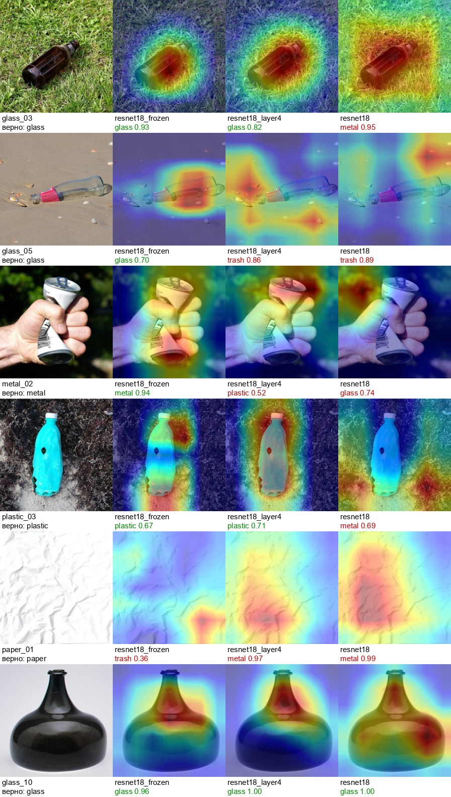
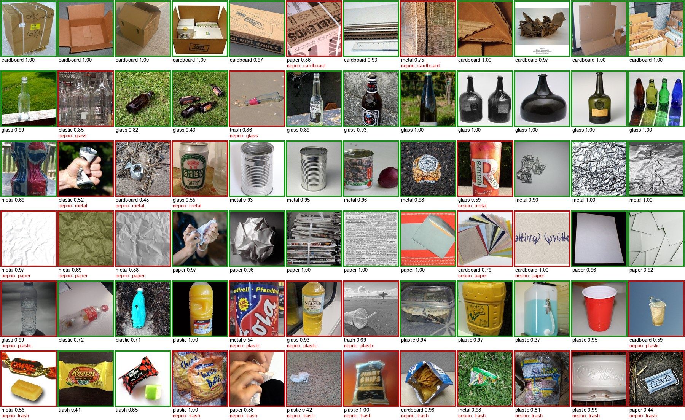
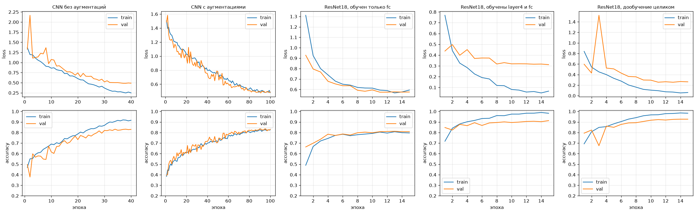
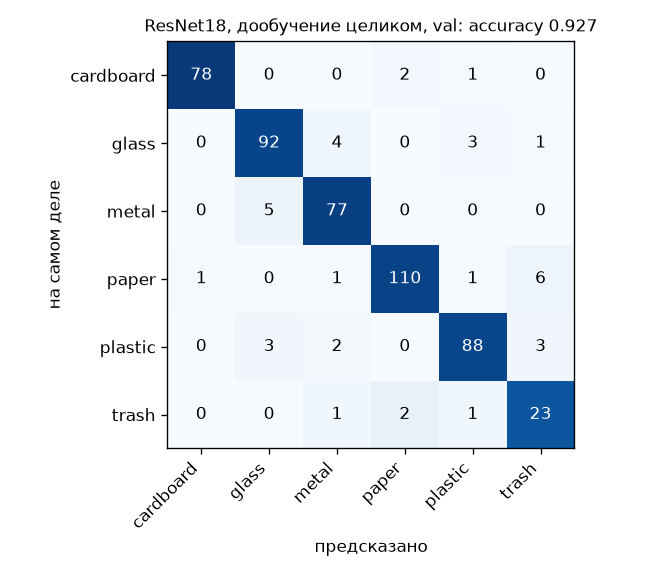
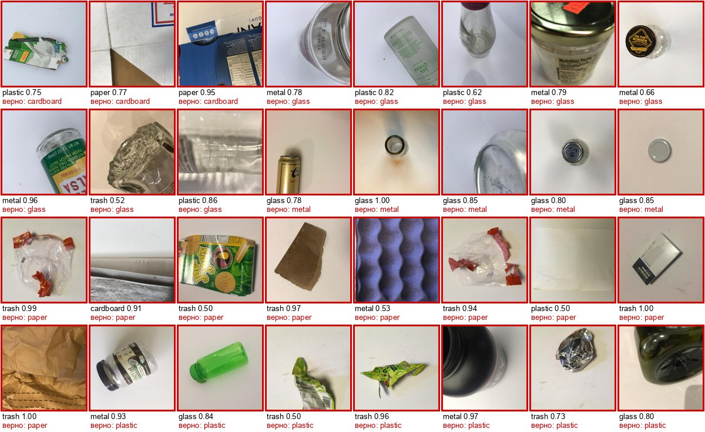
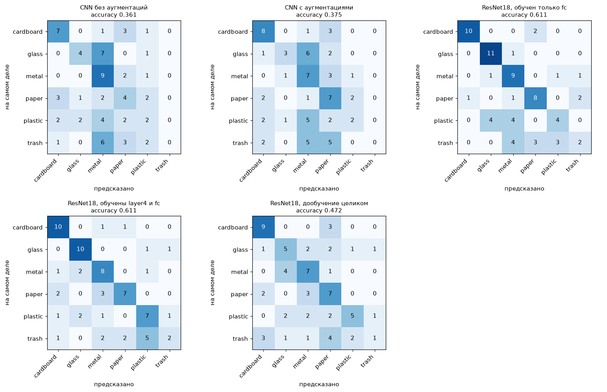

# Классификация мусора по фото свёрточными сетями

Лабораторная работа 3 по дисциплине «Системы компьютерной обработки изображений».

Выполнил: Молодиченко Семен Андреевич, группа P3413.

Программа получает фотографию предмета и определяет, из какого он материала, то есть в какой контейнер его выбрасывать при раздельном сборе. Классов шесть, как в датасете TrashNet [6]:

| Класс | Что это | Примеры |
|---|---|---|
| `cardboard` | картон | коробки, гофрокартон |
| `glass` | стекло | бутылки, банки |
| `metal` | металл | жестяные и алюминиевые банки, фольга |
| `paper` | бумага | газеты, листы, конверты, мятая бумага |
| `plastic` | пластик | бутылки, контейнеры, стаканчики |
| `trash` | несортируемый мусор | обёртки, пакеты из-под снеков, салфетки |

Обучены и сравниваются две архитектуры: своя небольшая свёрточная сеть, обученная с нуля, и ResNet18, предобученная на ImageNet и дообученная на TrashNet в трёх вариантах (обучается только последний слой, последний блок и последний слой, вся сеть). Качество оценивается на валидационной части TrashNet и на собственной тестовой выборке из 72 изображений, собранной с Wikimedia Commons и размеченной вручную.

Главный результат:

| Модель | Accuracy на val (TrashNet) | Accuracy на своём тесте (72 фото из интернета) |
|---|---|---|
| своя CNN, с нуля | 83.0% | 37.5% |
| ResNet18, обучен только последний слой | 80.8% | 61.1% |
| ResNet18, обучены последний блок и последний слой | 91.3% | **61.1%** |
| ResNet18, дообучение целиком | **92.7%** | 47.2% |

На валидации, которая снята так же, как обучающие фото (предмет на светлом фоне), ResNet18 даёт 91–93%. На фотографиях из другого источника точность всех моделей падает, и сильнее всего у той, что лучше всех на валидации. Grad-CAM показывает причину: дообученная целиком сеть на фото с травой или песком смотрит на фон, а не на предмет (раздел 3).



## 1. Теоретическая база

### Задача классификации

Классификатор сопоставляет изображению x вектор из K чисел (логитов) z₁, …, z_K, по одному на класс. Функция softmax переводит логиты в вероятности:

```
p_k = exp(z_k) / Σ_j exp(z_j)
```

Ответом считается класс с наибольшей вероятностью. Обучение подбирает веса так, чтобы на размеченных примерах вероятность правильного класса y была как можно ближе к 1. Для этого минимизируется перекрёстная энтропия (cross-entropy):

```
L = −(1/N) · Σ_i log p_{y_i}(x_i)
```

Если сеть уверенно ошибается (p_y близко к 0), штраф очень большой; если уверенно права, близок к нулю. Минимум ищется градиентным спуском: градиент L по всем весам считается обратным распространением ошибки (backpropagation), и веса сдвигаются против градиента. Градиент считается не по всей выборке, а по мини-батчу из 32 изображений (стохастический градиентный спуск) [9].

### Свёрточная сеть

Полносвязный слой на изображении 224×224×3 потребовал бы по 150 528 весов на каждый нейрон. Свёрточный слой [1] вместо этого применяет ко всему изображению одно и то же маленькое ядро:

```
y(c', i, j) = b(c') + Σ_c Σ_{u,v ∈ −1..1} w(c', c, u, v) · x(c, i + u, j + v)
```

Здесь ядро 3×3, c — входной канал, c' — выходной. У такого слоя два важных свойства:

- **локальность**: каждый выход зависит только от окрестности 3×3, то есть слой ищет локальные узоры (края, углы, текстуры);
- **общие веса**: один и тот же детектор узора применяется во всех точках изображения, поэтому параметров мало (у свёртки 3×3 из 64 в 128 каналов 73 728 весов при любом размере изображения), а сдвиг объекта сдвигает и отклик.

Сеть собирается из повторяющихся блоков:

- **свёртка** выделяет признаки;
- **BatchNorm** [3] нормирует выходы свёртки по батчу (среднее 0, дисперсия 1, затем обучаемые масштаб и сдвиг), это ускоряет и стабилизирует обучение;
- **ReLU**, max(0, x), даёт нелинейность, без неё вся сеть была бы одним линейным преобразованием;
- **max-pooling 2×2** уменьшает карту признаков вдвое по каждой стороне.

После каждого уменьшения следующая свёртка 3×3 видит вдвое большую область исходного изображения (рецептивное поле растёт). Первые слои находят края и пятна, следующие собирают из них текстуры и части предметов, последние реагируют на целые объекты [8]. В конце карта признаков усредняется по пространству (global average pooling), и полносвязный слой переводит полученный вектор в K логитов.

### ResNet

Если просто наращивать число слоёв, начиная с некоторой глубины сеть учится хуже: ошибка растёт даже на обучающей выборке. Это проблема деградации, и дело в ней не в переобучении, а в том, что глубокую сеть трудно оптимизировать. В ResNet [2] каждый блок учит не всё преобразование целиком, а только добавку к своему входу:

```
y = ReLU( F(x) + x ),     F(x) = BN(conv3×3( ReLU(BN(conv3×3(x))) ))
```

Если блок не нужен, ему достаточно сделать F(x) ≈ 0. Кроме того, градиент по «короткому пути» (skip connection) проходит к ранним слоям без ослабления. ResNet18 устроена так:

```
вход 224×224×3
  conv 7×7, 64, шаг 2 → BN → ReLU → max-pool 3×3, шаг 2      56×56×64
  2 базовых блока, 64 канала                                   56×56×64
  2 базовых блока, 128 каналов (первый с шагом 2)              28×28×128
  2 базовых блока, 256 каналов                                 14×14×256
  2 базовых блока, 512 каналов                                  7×7×512
  global average pooling → полносвязный слой                   512 → K
```

Это 17 свёрточных слоёв и один полносвязный, 11.7 млн параметров, 1.8 GFLOPs на изображение 224×224. Предобученные веса в torchvision дают на ImageNet точность top-1 69.8% [10].

### Перенос обучения (transfer learning)

ImageNet [7] содержит 1.28 млн изображений 1000 классов. Признаки, которые сеть выучила на нём, особенно в первых слоях (края, текстуры, формы), полезны и для других задач с фотографиями [8]. Поэтому при малом датасете (в TrashNet 2527 изображений) сеть берут предобученной и заменяют только последний слой на новый, с нужным числом классов. Дальше есть два варианта:

- **feature extractor**: все слои, кроме нового, заморожены, обучается только последний слой. Это логистическая регрессия на готовых признаках ImageNet;
- **fine-tuning**: обучается вся сеть, но с небольшим шагом, чтобы не разрушить полезные признаки.

Есть и промежуточный вариант: заморозить первые слои и обучать только последние. Ранние слои ResNet находят общие признаки (края, текстуры), а последние блоки специфичны для задачи, на которой сеть училась [8], поэтому переучивать имеет смысл в первую очередь их.

### Переобучение и как его распознать

Сеть с миллионами параметров может просто запомнить 2000 обучающих изображений. Тогда loss на обучении продолжает падать, а на отложенной выборке, которую сеть не видела, перестаёт падать и начинает расти. Признаки переобучения:

- кривые train loss и val loss расходятся: train падает, val растёт;
- точность на train близка к 100%, а на val заметно ниже (разрыв обобщения).

Способы борьбы, которые используются в работе:

- **аугментации**: на каждой эпохе сеть видит изображение в новом варианте (случайный кроп, отражение, поворот, изменение яркости и цвета). Запомнить конкретные пиксели становится нельзя, приходится учить признаки, устойчивые к этим изменениям;
- **dropout** [11]: перед последним слоем на каждом шаге обучения случайные 30% признаков обнуляются, и сеть не может полагаться на какой-то один признак;
- **weight decay**: веса на каждом шаге немного стягиваются к нулю (AdamW [4]);
- **предобученные веса**: сеть начинает не со случайной точки, а с хороших признаков, и ей нужно меньше подстраиваться под конкретную выборку.

### Метрики качества

По результатам на выборке строится матрица ошибок (confusion matrix): элемент (i, j) равен числу изображений класса i, которые сеть отнесла к классу j. По ней считаются:

```
accuracy    = Σ_i cm(i, i) / N                         доля верных ответов
precision_k = cm(k, k) / Σ_i cm(i, k)                  сколько из предсказанных «k» на самом деле k
recall_k    = cm(k, k) / Σ_j cm(k, j)                  сколько объектов класса k найдено
F1_k        = 2 · precision_k · recall_k / (precision_k + recall_k)
macro-F1    = (1/K) · Σ_k F1_k
```

Классы в TrashNet несбалансированы: `trash` в 4.3 раза меньше, чем `paper`. Accuracy можно поднять, почти никогда не предсказывая редкий класс, а macro-F1 даёт всем классам одинаковый вес, поэтому плохая работа на `trash` сразу видна. Основная метрика в работе — macro-F1, accuracy приводится рядом.

### Сдвиг данных

Метрика на валидационной выборке показывает качество только на данных из того же распределения, что и обучение. В TrashNet все фотографии сделаны одинаково: один предмет на белом или светло-сером фоне, похожее освещение. Фотографии из интернета устроены иначе: другой фон, несколько предметов, предмет в руке или на траве. Если обучающая и рабочая выборки различаются (domain shift, dataset bias [17]), качество на рабочих данных может быть заметно ниже, чем на валидации. Поэтому тестовая выборка в работе собрана из другого источника.

### Grad-CAM

Чтобы понять, на что смотрит сеть, используется Grad-CAM [14]. Берётся выход последнего свёрточного блока, карты признаков A_k размером 7×7, и градиент оценки предсказанного класса z_c по этим картам. Вес каждой карты равен среднему градиенту по ней, а карта значимости равна взвешенной сумме карт:

```
α_k = mean_{i,j} ∂z_c / ∂A_k(i, j)
L   = ReLU( Σ_k α_k · A_k )
```

Карта L растягивается до размера изображения. Красные области сильнее всего увеличивают оценку выбранного класса, то есть на них сеть опиралась при ответе.

### Оценка на малой выборке

На 72 тестовых изображениях одна ошибка меняет accuracy на 1.4 процентного пункта, поэтому одних точечных оценок мало.

- **Доверительный интервал Уилсона** [15] для доли верных ответов k из n даёт диапазон, в котором с вероятностью 95% лежит настоящая точность модели. При n = 72 и точности около 50% его ширина составляет примерно ±11 п.п.
- **Тест Макнемара** [16] сравнивает две модели на одних и тех же изображениях. Учитываются только изображения, на которых модели расходятся: b — верно только у первой, c — верно только у второй. Если модели одинаково хороши, b и c распределены как бином с p = 0.5, и p-value показывает, насколько неправдоподобно наблюдаемое расхождение. Парный тест чувствительнее, чем сравнение двух интервалов, потому что убирает разницу в трудности изображений.
- **Поправка Холма** [18]. Если сравнить много пар моделей, какое-нибудь p-value окажется меньше 0.05 просто случайно. Поправка Холма увеличивает p-value с учётом числа сравнений: наименьшее умножается на m, следующее на m − 1 и так далее. Значимыми считаются сравнения, у которых скорректированное значение меньше 0.05.

## 2. Описание разработанной системы

### Структура проекта

```
lab3/
|-- data.py            # список классов, чтение изображений, разбиение train/val, аугментации
|-- models.py          # SimpleCNN и три варианта ResNet18, сохранение и загрузка
|-- metrics.py         # матрица ошибок, accuracy, precision, recall, F1, macro-F1
|-- train.py           # обучение одной модели, история по эпохам
|-- evaluate.py        # метрики всех моделей на train/val/test, графики, таблицы
|-- gradcam.py         # карты Grad-CAM для ResNet18
|-- main.py            # CLI: классифицировать фото или папку
|-- collect_test.py    # скачать тестовую выборку по списку источников
|-- test_lab3.py       # тесты pytest
|-- requirements.txt
|-- data/
|   |-- trashnet/      # TrashNet (не в репозитории, скачивается отдельно)
|   `-- test/          # собственная тестовая выборка + sources.csv
|-- models/            # обученные веса (в репозитории resnet18_layer4.pt и cnn.pt)
`-- results/           # графики, таблицы, логи обучения
```

### Архитектура

```
     data/trashnet (2527 фото)                     data/test (72 фото)
              |                                            |
     split: 80% train / 20% val                            |
     (стратифицированно, seed 42)                          |
        |                  |                               |
        v                  v                               v
   аугментации       resize 224 + центр. кроп 224   resize 224 + центр. кроп 224
        |                  |                               |
        v                  |                               |
   train.py ----------> модель <-----------------------evaluate.py
   AdamW, CrossEntropy,   |  cnn / resnet18_frozen /       |
   косинусный шаг         |  resnet18_layer4 / resnet18    v
        |                 |                     метрики, матрицы ошибок,
        v                 |                     кривые, сетка предсказаний
   models/<имя>.pt -------+---------> main.py: фото -> класс и вероятность
```

### Данные

**Обучение и валидация: TrashNet** [6]. 2527 фотографий 512×384, 6 классов. По описанию авторов, предмет клали на белый лист ватмана и снимали на iPhone при дневном и/или комнатном освещении. Лицензия MIT. Датасет делится на train и val в пропорции 80/20 отдельно внутри каждого класса (стратифицированно), с фиксированным seed 42, поэтому доля классов в обеих частях одинакова и разбиение воспроизводится. Список файлов каждой части сохраняется в `results/split.csv`, а `evaluate.py` проверяет, что считает метрики на том же разбиении.

Почти одинаковые снимки в TrashNet искались по перцептивному хешу (уменьшенная до 16×16 копия, 256 бит «ярче среднего или нет»). У 18 изображений val есть почти такая же картинка в train: расстояние хеша не больше 10 из 256. Среди них два точных дубля с **разными метками**: один и тот же снимок лежит в датасете как `metal91.jpg` и `glass115.jpg`, другой как `glass176.jpg` и `plastic152.jpg`. Это шум разметки самого датасета. Остальные пары — один и тот же предмет, снятый почти без изменений (например, `paper246` и `paper349`). Если убрать эти 18 изображений, accuracy на val почти не меняется и даже немного растёт (у `resnet18` с 92.7% до 93.2%, столбец `val_acc_nodup` в `results/summary.csv`), потому что на дублях с разными метками модель ошибается неизбежно. Хеш находит только почти пиксельные копии. Если в TrashNet один предмет снимали под разными углами, такие снимки он не найдёт, и они могут попасть по разные стороны разбиения. Тогда val-оценка немного оптимистична.

| Класс | Всего | train | val |
|---|---|---|---|
| cardboard | 403 | 322 | 81 |
| glass | 501 | 401 | 100 |
| metal | 410 | 328 | 82 |
| paper | 594 | 475 | 119 |
| plastic | 482 | 386 | 96 |
| trash | 137 | 110 | 27 |
| **всего** | **2527** | **2022** | **505** |

**Тестовая выборка: собственная, 72 изображения.** Собрана вручную на Wikimedia Commons [13], по 12 изображений на класс. Кандидаты искались по запросам вроде «cardboard box», «empty glass bottle», «crushed beverage can», «crumpled paper», «PET bottle», «crisp packet», «candy wrapper». Из примерно 260 найденных изображений отобраны и размечены по таким правилам:

- это фотография, а не рисунок, схема или 3D-рендер;
- на снимке один главный предмет или кучка предметов из одного материала;
- материал однозначен: керамический кувшин, найденный по запросу «glass jar», отброшен, бутылка рядом со стаканом напитка тоже;
- нет почти одинаковых кадров одной серии;
- в `trash` попадает несортируемый мусор того же рода, что в TrashNet: обёртки от конфет, пакеты из-под чипсов, использованные салфетки. Добавлены также пенопластовый контейнер и одноразовая маска: их в TrashNet нет, но в переработку они тоже не идут.

Изображения уменьшены до 512 пикселей по длинной стороне и лежат в `data/test/<класс>/`. В `data/test/sources.csv` для каждого файла указаны страница на Commons, автор и лицензия (CC BY-SA, CC BY, CC0, общественное достояние). `collect_test.py` скачивает выборку заново по этому списку. Тест `test_test_set_not_in_trashnet` проверяет, что среди тестовых изображений нет копий из TrashNet.



*Вся тестовая выборка, по строке на класс: картон, стекло, металл, бумага, пластик, мусор. Подписи показывают ответ итоговой модели `resnet18_layer4` (разбор в разделе 3).*

Тестовые снимки устроены иначе, чем TrashNet. Чтобы это измерить, у каждого изображения вручную отмечен тип фона (колонка `background` в `sources.csv`):

| Фон | Критерий | Изображений |
|---|---|---|
| `light` | светлая однотонная гладкая поверхность (белый лист, светлый стол, студийный фон), как в TrashNet | 19 |
| `closeup` | материал заполняет весь кадр, фона нет (мятая бумага, гофрокартон крупным планом) | 12 |
| `scene` | всё остальное: трава, песок, асфальт, тёмный или цветной фон, интерьер, предмет в руке | 41 |

Сначала я пробовал определять тип фона автоматически, по яркости и разбросу пикселей вдоль края кадра. Признак оказался ненадёжным: даже из самого TrashNet под «светлый однотонный фон» попадало только 55% снимков, потому что предмет часто касается края кадра, а по фону идут тени. Поэтому разметка ручная.

### Модели

**Своя сеть `cnn` (SimpleCNN).** Пять одинаковых блоков, после каждого изображение уменьшается вдвое:

```
вход 224×224×3
  блок 1: [conv 3×3 → BN → ReLU] ×2, 16 каналов → max-pool 2×2    112×112×16
  блок 2: то же, 32 канала                                         56×56×32
  блок 3: 64 канала                                                28×28×64
  блок 4: 128 каналов                                              14×14×128
  блок 5: 256 каналов                                               7×7×256
  global average pooling → dropout 0.3 → полносвязный слой         256 → 6
```

1.18 млн параметров и 0.83 млрд умножений-сложений на изображение, то есть вдвое меньше вычислений, чем у ResNet18 (1.8 млрд). Число каналов растёт, когда разрешение падает, поэтому все блоки, кроме первого, стоят одинаково. Первый вариант был шире (4 блока, 32–256 каналов), но тяжёлые свёртки на полном разрешении замедляли эпоху вдвое (37 с вместо 16 с чистого счёта), и я сузил первые блоки, добавив пятый.

**ResNet18** из torchvision с весами ImageNet [10]. Последний слой 512 → 1000 заменён на 512 → 6. Три варианта обучения:

| Вариант | Что обучается | Обучаемых параметров |
|---|---|---|
| `resnet18_frozen` | только новый последний слой | 3 078 |
| `resnet18_layer4` | последний блок `layer4` и последний слой | 8 396 806 |
| `resnet18` | вся сеть | 11 179 590 |

В замороженных частях BatchNorm остаётся в режиме оценки, чтобы его статистики ImageNet не подстраивались под новые данные.

Всего пять обучений:

| Запуск | Модель | Аугментации | Эпох | Шаг |
|---|---|---|---|---|
| `cnn_noaug` | cnn | нет | 40 | 1e-3 |
| `cnn` | cnn | да | 100 | 1e-3 |
| `resnet18_frozen` | resnet18_frozen | да | 15 | 1e-3 |
| `resnet18_layer4` | resnet18_layer4 | да | 15 | 3e-4 |
| `resnet18` | resnet18 | да | 15 | 3e-4 |

### Обучение

| Параметр | Значение |
|---|---|
| loss | CrossEntropy |
| оптимизатор | AdamW, weight decay 1e-4 |
| шаг обучения | 1e-3 для CNN и `resnet18_frozen`, 3e-4 для `resnet18_layer4` и `resnet18` |
| расписание шага | косинусное: от начального значения до 0 за всё обучение [5] |
| эпох | 100 для CNN (40 для CNN без аугментаций), 15 для ResNet18 |
| батч | 32 |
| размер входа | 224×224, нормировка средним и СКО ImageNet |
| аугментации | `RandomResizedCrop(224, scale=(0.5, 1))`, отражения по горизонтали и вертикали, поворот до ±15°, `ColorJitter(0.3, 0.3, 0.3, 0.05)` |
| проверка | `Resize(224)` по короткой стороне, `CenterCrop(224)` |

Отражение по вертикали допустимо: мусор лежит как угодно, у бутылки или коробки нет «верха» на фото. Число эпох фиксировано, и сохраняются веса после последней эпохи, лучшая эпоха по val не выбирается. Шаг и остальные параметры взяты типовыми и по val не подбирались. Единственное решение, принятое по val: CNN с аугментациями за 40 эпох оказалась недообучена, и для неё взято 100 эпох (раздел 3).

Обучение на MPS не воспроизводится бит в бит даже при фиксированном seed, поэтому при повторном обучении метрики могут отличаться на доли процента. Оценка готовых весов (`evaluate.py`) воспроизводится полностью.

### Системные требования

- Python 3.10+ (проверено на 3.14), PyTorch 2.x, torchvision, Pillow, NumPy, Matplotlib (версии в `requirements.txt`);
- обучение шло на Apple M1 (16 ГБ) через бэкенд MPS. Скрипты сами выбирают MPS, CUDA или CPU, что доступно;
- для обучения на CPU нужно заметно больше времени, для классификации готовой моделью хватает любого компьютера;
- место на диске: TrashNet 43 МБ, веса ResNet18 45 МБ, своей CNN 4.7 МБ.

В репозитории лежат веса итоговой модели `resnet18_layer4` и своей CNN. Остальные модели (по 45 МБ) не выложены из-за размера, они получаются командами обучения ниже; `evaluate.py` и `gradcam.py` берут те модели, что есть в `models/`.

### Запуск

```bash
python3 -m venv .venv
source .venv/bin/activate
pip install -r requirements.txt

# TrashNet
curl -L -o trashnet.zip https://github.com/garythung/trashnet/raw/master/data/dataset-resized.zip
unzip -q trashnet.zip -x '__MACOSX/*' && mv dataset-resized data/trashnet

# обучение
python3 train.py --model cnn --no-aug --name cnn_noaug --epochs 40
python3 train.py --model cnn
python3 train.py --model resnet18_frozen
python3 train.py --model resnet18_layer4
python3 train.py --model resnet18

# оценка всех моделей: results/
python3 evaluate.py

# классификация своего фото (по умолчанию models/resnet18_layer4.pt)
python3 main.py photo.jpg
python3 main.py data/test/glass --model models/cnn.pt

# карты Grad-CAM трёх вариантов ResNet18 (картинка из отчёта: results/gradcam.jpg)
T=data/test
python3 gradcam.py $T/glass/glass_03.jpg $T/glass/glass_05.jpg $T/metal/metal_02.jpg \
    $T/plastic/plastic_03.jpg $T/paper/paper_01.jpg $T/glass/glass_10.jpg

pytest -v
```

Параметры `train.py`:

| Параметр | Значение |
|---|---|
| `--model` | `cnn`, `resnet18_frozen`, `resnet18_layer4` или `resnet18` |
| `--name` | имя запуска, по нему называются веса и история (по умолчанию как модель) |
| `--epochs`, `--lr` | число эпох и начальный шаг (по умолчанию из таблиц выше) |
| `--no-aug` | обучать без аугментаций |
| `--batch`, `--seed`, `--workers` | размер батча (32), seed (42), процессов загрузки данных (4) |

Пример вывода `main.py`:

```
$ python3 main.py data/test/glass/glass_03.jpg data/test/paper/paper_05.jpg data/test/trash/trash_09.jpg
data/test/glass/glass_03.jpg: glass (стекло) 0.82, metal (металл) 0.18, plastic (пластик) 0.00
data/test/paper/paper_05.jpg: paper (бумага) 0.96, metal (металл) 0.03, trash (мусор) 0.01
data/test/trash/trash_09.jpg: metal (металл) 0.98, glass (стекло) 0.01, plastic (пластик) 0.00
```

Третий ответ ошибочный: обёртка от конфеты на траве принята за металл (подробнее в разделе 3).

## 3. Результаты работы и тестирования

Всё ниже получено командами из раздела «Запуск» на Apple M1 (MPS). Таблицы лежат в `results/*.csv`, логи обучения в `results/train_log_*.txt`.

### Сводная таблица

| Запуск | train acc | val acc | val macro-F1 | test acc [95% ДИ] | test macro-F1 | обучение | мс/изобр. |
|---|---|---|---|---|---|---|---|
| `cnn_noaug` | 95.7% | 83.0% | 0.808 | 36.1% [26.0–47.6] | 0.320 | 15.7 мин | 3.6 |
| `cnn` | 89.3% | 83.0% | 0.799 | 37.5% [27.2–49.0] | 0.329 | 35.5 мин | 3.7 |
| `resnet18_frozen` | 80.9% | 80.8% | 0.765 | 61.1% [49.6–71.5] | 0.585 | 2.8 мин | 5.7 |
| `resnet18_layer4` | 99.9% | 91.3% | 0.886 | **61.1%** [49.6–71.5] | **0.588** | 3.7 мин | 5.7 |
| `resnet18` | 99.8% | **92.7%** | **0.909** | 47.2% [36.1–58.6] | 0.448 | 8.7 мин | 5.7 |

- train acc посчитана после обучения на обучающей части без аугментаций, так же, как на val;
- в квадратных скобках 95%-доверительный интервал Уилсона;
- время классификации одного изображения (батч из одного) замерено на MPS.

### Кривые обучения



Синяя линия показывает train, оранжевая val. Train loss и train accuracy на графике считаются по ходу эпохи на аугментированных изображениях и с включённым dropout, поэтому у моделей с аугментациями они хуже, чем «чистая» train acc в таблице.

### Переобучилась ли модель

Если смотреть на валидацию, классического переобучения нет ни у одной модели: val loss ни у кого не начинает расти к концу обучения.

| Запуск | Минимум val loss (эпоха) | val loss в конце | train loss в конце эпохи | Разрыв train / val acc |
|---|---|---|---|---|
| `cnn_noaug` | 0.486 (38) | 0.490 | 0.249 | 12.7 п.п. |
| `cnn` | 0.476 (91) | 0.486 | 0.480 | 6.3 п.п. |
| `resnet18_frozen` | 0.574 (11) | 0.575 | 0.594 | 0.1 п.п. |
| `resnet18_layer4` | 0.311 (15) | 0.311 | 0.066 | 8.6 п.п. |
| `resnet18` | 0.255 (13) | 0.263 | 0.060 | 7.1 п.п. |

- **`resnet18` и `resnet18_layer4` почти запомнили обучающую выборку**: train acc 99.8–99.9%, loss на train без аугментаций 0.01, на val 0.26–0.31. Но val loss выходит на плато и не растёт, а val accuracy до последней эпохи держится на максимуме (92.7% и 91.3%). Значит, сеть подогналась под train, но качество на данных того же вида от этого не пострадало. Такое переобучение безвредно: брать веса с более ранней эпохи смысла нет.
- **`cnn_noaug`**: я ожидал здесь явного переобучения, потому что без аугментаций сеть 40 эпох видит одни и те же 2022 картинки. Но val loss падал до 38-й эпохи. Разрыв train/val у неё самый большой из всех (95.7% против 83.0%), но кривые не расходятся. Видимо, сеть слишком мала (1.2 млн параметров, global average pooling вместо большого полносвязного слоя), а dropout, weight decay и затухающий шаг дополнительно удерживают её от запоминания.
- **`cnn` с аугментациями**: train и val кривые идут вместе на протяжении всех 100 эпох, разрыв 6.3 п.п. Аугментации уменьшили разрыв вдвое, но val accuracy та же, 83.0%. Учится такая сеть медленнее: за 40 эпох она дошла только до 74.1% (запуск `cnn_e40`, `results/history_cnn_e40.csv`), её train accuracy была ниже val, то есть сеть была недообучена. Поэтому для неё взято 100 эпох.
- **`resnet18_frozen` недообучен**: train и val совпадают (80.9% и 80.8%). Линейного классификатора на готовых признаках ImageNet не хватает, чтобы отличать материалы так же хорошо, как сеть с дообученными слоями.

Переобучение другого рода видно только на тестовой выборке: это подгонка не под конкретные картинки, а под то, как снят весь датасет. Подробнее ниже.

### Качество на валидации

Лучшая по macro-F1 на val модель — `resnet18` (accuracy 92.7%, macro-F1 0.909, 37 ошибок из 505). Для ориентира: авторы TrashNet со своей CNN получили около 75% на собственном разбиении 70/13/17 [6]. Разбиения разные, поэтому цифры сравнимы только приблизительно.



| Класс | precision | recall | F1 | изображений |
|---|---|---|---|---|
| cardboard | 0.987 | 0.963 | 0.975 | 81 |
| glass | 0.920 | 0.920 | 0.920 | 100 |
| metal | 0.906 | 0.939 | 0.922 | 82 |
| paper | 0.965 | 0.924 | 0.944 | 119 |
| plastic | 0.936 | 0.917 | 0.926 | 96 |
| trash | 0.697 | 0.852 | 0.767 | 27 |

Хуже всех `trash`: его в 3–4 раза меньше остальных классов, и он сборный, в нём есть и плёнка, и бумажные упаковки, и фольгированные обёртки. Остальные ошибки в основном приходятся на прозрачные и блестящие предметы: стекло, металл и пластик путаются между собой.



*Первые 32 ошибки `resnet18` на val. Подпись: ответ сети и уверенность, ниже правильный класс.* Часть ошибок спорная и для человека: крышка от банки, снятая сверху; прозрачная бутылка без этикетки; прозрачная упаковка с наклейками, которая в TrashNet подписана как `paper`.

### Качество на собственной тестовой выборке

Точность всех моделей на тесте заметно ниже, чем на val: у ResNet18 61% против 91–93%, у своей CNN 36–38% против 83%.



Сколько изображений каждого класса из 12 распознано верно:

| Класс | `cnn_noaug` | `cnn` | `resnet18_frozen` | `resnet18_layer4` | `resnet18` |
|---|---|---|---|---|---|
| cardboard | 7 | 8 | 10 | 10 | 9 |
| glass | 4 | 3 | **11** | 10 | 5 |
| metal | 9 | 7 | 9 | 8 | 7 |
| paper | 4 | 7 | 8 | 7 | 7 |
| plastic | 2 | 2 | 4 | 7 | 5 |
| trash | 0 | 0 | 2 | 2 | 1 |
| **всего из 72** | 26 | 27 | 44 | 44 | 34 |

Точность в зависимости от фона (тип фона размечен вручную, см. раздел 2):

| Запуск | `light`, 19 фото | `closeup`, 12 фото | `scene`, 41 фото |
|---|---|---|---|
| `cnn_noaug` | 47.4% | 33.3% | 31.7% |
| `cnn` | 63.2% | 58.3% | 19.5% |
| `resnet18_frozen` | 73.7% | 58.3% | 56.1% |
| `resnet18_layer4` | 84.2% | 41.7% | 56.1% |
| `resnet18` | 63.2% | 41.7% | 41.5% |

Парные сравнения на одних и тех же 72 изображениях (тест Макнемара, `results/mcnemar.csv`; поправка Холма сделана на все 10 пар моделей):

| Модель A | Модель B | верно только у A | верно только у B | p-value | с поправкой Холма |
|---|---|---|---|---|---|
| `resnet18_layer4` | `resnet18` | 15 | 5 | 0.041 | 0.25 |
| `resnet18_frozen` | `resnet18` | 16 | 6 | 0.053 | 0.26 |
| `resnet18_frozen` | `resnet18_layer4` | 10 | 10 | 1.0 | 1.0 |
| `cnn` | `cnn_noaug` | 10 | 9 | 1.0 | 1.0 |
| `cnn` | `resnet18_layer4` | 4 | 21 | 0.0009 | **0.008** |
| `cnn` | `resnet18_frozen` | 6 | 23 | 0.0023 | **0.016** |

После поправки на число сравнений значим только один вывод: ResNet18 с замороженными ранними слоями (`resnet18_frozen` и `resnet18_layer4`) лучше обеих своих CNN (скорректированные p от 0.001 до 0.016, остальные пары в `results/mcnemar.csv`). Полностью дообученная `resnet18` значимо от CNN не отличается (p = 0.39 и 0.50). Разница между вариантами ResNet18 на тесте (61.1% против 47.2%) заметная, но на 72 изображениях её нельзя считать доказанной.

### Закономерности

1. **Предобучение на ImageNet важнее всего остального.** На val своя CNN отстаёт от ResNet18 на 8–10 п.п., а на тесте уже на 24 п.п. (37.5% против 61.1%, p ≤ 0.016 с поправкой Холма). Сеть, обученная с нуля на 2022 картинках одного вида, учит признаки именно этих картинок. Признаки ImageNet получены на миллионе разнообразных фото и лучше переносятся на снимки другого вида.
2. **Чем сильнее дообучение, тем лучше на val и хуже на тесте.** От «только fc» к «layer4 + fc» и к «вся сеть» val растёт: 80.8 → 91.3 → 92.7%. Тест сначала не меняется (61.1 → 61.1%), а потом падает до 47.2%. `resnet18_layer4` на тесте верна там, где `resnet18` ошиблась, в 15 случаях, а наоборот в 5, хотя на val уступает всего 1.4 п.п. Отдельно это сравнение даёт p = 0.041, но с поправкой на 10 сравнений p = 0.25, так что это тенденция, а не доказанный факт. Объяснение согласуется с Grad-CAM (п. 3): перестраивая ранние слои, сеть подгоняет под TrashNet и низкоуровневые признаки, включая признаки фона.
3. **Сети опираются на фон.** На фото со светлым фоном, как в TrashNet, лучшая модель верна в 84% случаев, на сценах только в 56%. Grad-CAM (картинка в начале отчёта) показывает механизм. На бутылке в траве (`glass_03`) и на песке (`glass_05`) дообученная целиком сеть ответила «metal» и «trash», и красная область у неё лежит на траве и песке. У замороженной сети на тех же снимках красная область на бутылке, и ответ верный. На бутылке на белом фоне (`glass_10`) все три варианта смотрят на бутылку и отвечают верно. В TrashNet фон всегда светлый, поэтому признаки фона там бесполезны, и сеть не учится их игнорировать. Сочная трава для неё незнакомый сигнал, который сбивает ответ.
4. **Фактура вместо предмета.** Мятая бумага на весь кадр (`paper_01`–`paper_03`) у дообученных моделей становится металлом: в TrashNet такую мелкую блестящую складчатость имеет только фольга. Отсюда и провал на крупных планах (`closeup`): 41.7% у `resnet18_layer4` и `resnet18`.
5. **`trash` почти не распознаётся вне TrashNet.** Ни одна модель не нашла больше 2 из 12. В обучении этого класса всего 110 картинок, класс сборный, а масок и пенопласта в TrashNet нет совсем. Фольгированная обёртка похожа на металл, пакет чипсов на пластик, салфетка на бумагу. Различие тут не столько в материале, сколько в смысле предмета, и сеть его не выучила.
6. **Аугментации не спасают от сдвига данных.** У своей CNN аугментации уменьшили разрыв train/val, но не дали ничего ни на val (83.0% в обоих случаях), ни на тесте (36.1% и 37.5%, p = 1.0). Аугментации меняют кроп, поворот и цвет, но не фон, а главное отличие теста именно в фоне.
7. **Быстродействие.** Все модели классифицируют изображение за 3.6–5.7 мс на M1, этого с запасом хватает для работы в реальном времени. Свою CNN обучать дольше всех (35 мин), хотя одна её эпоха стоит меньше эпохи полной ResNet18 (21 с против 35 с): ей нужно в 7 раз больше эпох. Замороженную ResNet18 обучать быстрее всего (11 с на эпоху), потому что не считаются градиенты сети.

### Что пробовал

- **CNN с аугментациями, 40 эпох.** Модель была недообучена: 74.1% на val, train accuracy ниже val. За 100 эпох она дошла до 83.0%.
- **Частичное дообучение `resnet18_layer4`.** Добавлено после того, как оказалось, что замороженная сеть на тесте лучше полностью дообученной. Компромисс сработал: на val почти как полное дообучение, на тесте как замороженная сеть.
- **Автоматическое определение фона** по краю кадра. Признак ненадёжен (под «светлый фон» попадало только 55% самого TrashNet), заменён ручной разметкой.

### Итоговая модель

Для `main.py` по умолчанию выбрана `resnet18_layer4`. На val она уступает `resnet18` 1.4 п.п., зато на фото из другого источника верна на 10 изображений чаще (44 против 34 из 72). Важная оговорка: этот выбор сделан после того, как я увидел результаты на тесте. Поэтому 61.1% для неё оценка немного оптимистичная, честной оценкой будет следующая новая выборка. Модель, выбранная до теста по правилу «лучшая на val», дала на тесте 47.2%.

## 4. Выводы

1. Реализована система классификации фотографий мусора на 6 классов по материалу на PyTorch и torchvision. Обучены своя свёрточная сеть (1.2 млн параметров, с нуля) и ResNet18, предобученная на ImageNet, в трёх вариантах дообучения. Loss — перекрёстная энтропия, метрики — accuracy и macro-F1. Для оценки собрана и вручную размечена тестовая выборка из 72 фотографий с Wikimedia Commons, с указанием источника и лицензии каждой.
2. На валидационной части TrashNet лучшая модель (ResNet18, дообучение целиком) даёт accuracy 92.7% и macro-F1 0.909, своя CNN 83.0% и 0.80. Классического переобучения нет: val loss до конца обучения не растёт, хотя ResNet18 почти запоминает обучающую выборку (99.8%). Аугментации у своей CNN вдвое уменьшили разрыв train/val, но не изменили качество на val.
3. На собственной тестовой выборке качество всех моделей сильно ниже: 61.1% у лучших вариантов ResNet18 и 36–38% у своей CNN. Причина в сдвиге данных: в TrashNet предмет всегда лежит на светлом фоне, а в тесте снят на траве, песке, асфальте, в руке. На светлом фоне лучшая модель верна в 84% случаев, на остальных снимках в 56%. Grad-CAM показывает, что ошибающаяся сеть смотрит на фон, а не на предмет.
4. Модель, лучшая на валидации, не обязательно лучшая на практике. Полное дообучение ResNet18 дало лучший результат на val, но на тесте оказалось хуже частичного дообучения (47.2% против 61.1%). На 72 изображениях эта разница после поправки на множественные сравнения статистически не подтверждается (p = 0.25), но согласуется с картами Grad-CAM. Значимо подтверждается другое: предобученная ResNet18 с замороженными ранними слоями переносится на новые фото лучше, чем своя CNN, обученная с нуля (p ≤ 0.016). Если данных мало и они однообразны, разумно обучать только последние слои предобученной сети и обязательно проверять модель на данных из другого источника.
5. Хуже всего распознаётся класс `trash`: в обучении его меньше всего (110 картинок), он сборный, а на тесте ни одна модель не нашла больше 2 из 12. Для практического применения нужны обучающие фото с разными фонами и больше примеров несортируемого мусора. Подбор архитектуры и параметров обучения такой результат не даст.

## 5. Использованные источники

1. LeCun Y., Bottou L., Bengio Y., Haffner P. Gradient-Based Learning Applied to Document Recognition // Proceedings of the IEEE. 1998. Vol. 86, No. 11. P. 2278–2324.
2. He K., Zhang X., Ren S., Sun J. Deep Residual Learning for Image Recognition // IEEE Conference on Computer Vision and Pattern Recognition (CVPR). 2016. P. 770–778.
3. Ioffe S., Szegedy C. Batch Normalization: Accelerating Deep Network Training by Reducing Internal Covariate Shift // International Conference on Machine Learning (ICML). 2015.
4. Loshchilov I., Hutter F. Decoupled Weight Decay Regularization // International Conference on Learning Representations (ICLR). 2019.
5. Loshchilov I., Hutter F. SGDR: Stochastic Gradient Descent with Warm Restarts // International Conference on Learning Representations (ICLR). 2017.
6. Yang M., Thung G. Classification of Trash for Recyclability Status. CS229 Project Report, Stanford University, 2016. Датасет TrashNet: https://github.com/garythung/trashnet
7. Deng J., Dong W., Socher R., Li L.-J., Li K., Fei-Fei L. ImageNet: A Large-Scale Hierarchical Image Database // IEEE Conference on Computer Vision and Pattern Recognition (CVPR). 2009.
8. Yosinski J., Clune J., Bengio Y., Lipson H. How transferable are features in deep neural networks? // Advances in Neural Information Processing Systems (NeurIPS). 2014.
9. Goodfellow I., Bengio Y., Courville A. Deep Learning. MIT Press, 2016. Главы 6, 8, 9.
10. torchvision: ResNet18, веса `IMAGENET1K_V1`. https://pytorch.org/vision/stable/models/generated/torchvision.models.resnet18.html
11. Srivastava N., Hinton G., Krizhevsky A., Sutskever I., Salakhutdinov R. Dropout: A Simple Way to Prevent Neural Networks from Overfitting // Journal of Machine Learning Research. 2014. Vol. 15. P. 1929–1958.
12. PyTorch: Transfer Learning for Computer Vision Tutorial. https://pytorch.org/tutorials/beginner/transfer_learning_tutorial.html
13. Wikimedia Commons, источник тестовой выборки; авторы и лицензии каждого изображения в `data/test/sources.csv`. https://commons.wikimedia.org
14. Selvaraju R. R., Cogswell M., Das A., Vedantam R., Parikh D., Batra D. Grad-CAM: Visual Explanations from Deep Networks via Gradient-Based Localization // IEEE International Conference on Computer Vision (ICCV). 2017. P. 618–626.
15. Wilson E. B. Probable Inference, the Law of Succession, and Statistical Inference // Journal of the American Statistical Association. 1927. Vol. 22, No. 158. P. 209–212.
16. McNemar Q. Note on the Sampling Error of the Difference Between Correlated Proportions or Percentages // Psychometrika. 1947. Vol. 12, No. 2. P. 153–157.
17. Torralba A., Efros A. A. Unbiased Look at Dataset Bias // IEEE Conference on Computer Vision and Pattern Recognition (CVPR). 2011. P. 1521–1528.
18. Holm S. A Simple Sequentially Rejective Multiple Test Procedure // Scandinavian Journal of Statistics. 1979. Vol. 6, No. 2. P. 65–70.
